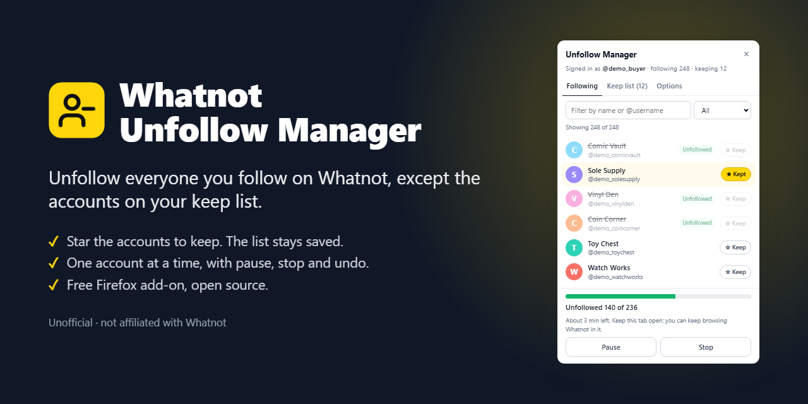

# Whatnot Unfollow Manager: bulk unfollow for Whatnot, with a keep list

**Install it: https://crande25.github.io/whatnot-unfollow-manager/**



Whatnot Unfollow Manager is a free Firefox add-on for cleaning up who you follow on Whatnot. Open its panel on whatnot.com and it lists every account you follow. Star the ones you want to keep, click **Unfollow N accounts**, confirm, and it unfollows the rest one account at a time while you watch. You can pause or stop it, retry the accounts that failed, or undo the whole run.

Your keep list stays saved in Firefox, so the next clean-up is three clicks: open the panel, **Unfollow N accounts**, **Yes, unfollow**. There's no account to create and nothing to set up. It runs in your browser with your existing Whatnot sign-in and talks only to Whatnot.

> **Unofficial.** Whatnot Unfollow Manager is not affiliated with, endorsed by or supported by Whatnot. It makes the same requests the Whatnot website makes when you unfollow someone, and Whatnot can change those at any time. Use it at your own risk and at a moderate speed, and make sure it fits Whatnot's terms of service.

## What it does

- Lists every account you follow, with a name filter and an All / To unfollow / Kept view.
- Keeps a keep list (a whitelist): **☆ Keep** on any account, **Keep all N shown** for a filtered set, or add an account by `@username` or profile link. Export it to a file and import it again. Accounts are matched by account number, so a kept account that changes its username stays kept.
- Unfollows everyone who isn't on the list, one account at a time with randomized pauses at Careful, Normal or Fast speed. It shows progress and the time left, and you can pause, resume or stop at any point.
- Backs off when Whatnot rate-limits it, and stops by itself when you're signed out, when Whatnot refuses its requests, or after 5 failures in a row. Failed accounts show the reason and can be retried.
- Undo: follows the accounts from your last bulk unfollow again.
- Never unfollows a kept account: each account is checked against the keep list again just before it's unfollowed.

## Install and use

1. Open the [install page](https://crande25.github.io/whatnot-unfollow-manager/) in Firefox, click **Add to Firefox**, and allow both of Firefox's prompts.
2. On [whatnot.com](https://www.whatnot.com), signed in, click the round yellow button in the bottom-left corner.
3. Click **☆ Keep** on the accounts to keep, then **Unfollow N accounts** and **Yes, unfollow**.

The install page also covers the keep list, how a run works, what to do when something goes wrong, and its limits.

## Requirements and limits

- Firefox 140 or later on a computer. Other browsers can't install it.
- A Whatnot account, signed in on whatnot.com.
- It goes one account at a time on purpose, so a long list takes a while: about 17 minutes per 500 accounts at Normal speed.
- It relies on how the Whatnot website works today and may stop working when Whatnot changes it.

## License

MIT. See [LICENSE](LICENSE).

## For maintainers

### Files

| File | What it is |
| --- | --- |
| `manifest.json` | The add-on manifest (Manifest V3 for Firefox). Its `version` is the add-on's version. |
| `src/background.js` | The toolbar button and Alt+Shift+U: toggles the panel, or opens Whatnot first. |
| `src/page/bridge.js` | Runs in the page itself and makes the GraphQL calls with the page's own `fetch`. |
| `src/content/*.js` | The panel, in load order: `util` (helpers), `styles` (CSS), `store` (keep list, settings and undo record), `api` (GraphQL client), `runner` (pacing and back-off), `panel` (UI), `main` (entry point). |
| `icons/` | The add-on's icons. |
| `build.ps1` | Builds the zip to sign, `install.html` and `updates.json`. With `-Signed`, it first takes in a file Mozilla signed. |
| `install.template.html` | The install page. The build fills in `{{VERSION}}` and `{{XPI}}`, and keeps either the signed or the unsigned part. |
| `install.html` | Generated. Don't edit it by hand. GitHub Pages serves it. |
| `updates.json` | Generated. Firefox's update manifest: installed copies check it daily for new versions. |
| `xpi/` | The files Mozilla signed, one per version. The install page links to the newest. |
| `index.html` | Sends visitors from the Pages root to `install.html`. |
| `images/preview.png` | The picture for link previews and this README, made with demo accounts. |
| `dev/firefox-test.ps1` | Smoke test in a throwaway headless Firefox. |
| `.gitattributes` | Keeps LF line endings in every checkout, so the zip built from a clone matches the signed file byte for byte. |
| `.nojekyll` | Makes GitHub Pages serve the files as they are. Jekyll would read the `{{…}}` placeholders in the Markdown files as template tags. |
| `CHANGELOG.md` | Every change, newest first. |

### Making a change

1. Edit the add-on, and `install.template.html` if what users see changes.
2. Run the smoke test (see below).
3. Bump `version` in `manifest.json`, and move the changelog's Unreleased entries under that version.
4. Build: `powershell -ExecutionPolicy Bypass -File build.ps1`. It writes `dist\whatnot-unfollow-manager-<version>.zip`.
5. Get it signed: on the [Add-on Developer Hub](https://addons.mozilla.org/developers/), upload the zip as a new version, distributed **On your own** (the very first upload is **Submit a New Add-on**). Mozilla checks and signs it, usually within minutes. Download the signed `.xpi`.
6. Take it in: `powershell -ExecutionPolicy Bypass -File build.ps1 -Signed <the downloaded .xpi>`. It checks that the file is this add-on, at this version, made of exactly these files plus Mozilla's signature. Then it copies it to `xpi/` and rebuilds `install.html` and `updates.json`.
7. Commit and push. Pages publishes the new install page and update manifest, and installed copies update themselves within a day.

Mozilla signs each version number only once, so any change after an upload needs a new version number. Keep `update_url` in `manifest.json` as it is (the build checks it): an installed copy only ever checks the URL it was installed with. On Windows, use Windows PowerShell 5.1 as above. On other systems, `pwsh build.ps1` with PowerShell 7 should work, but it hasn't been tried there.

### How it talks to Whatnot

Every request goes from a whatnot.com page to `POST /services/graphql/?operationName=<name>&ssr=0` on the same origin, with the signed-in user's own session cookie. Whatnot doesn't document this API. The operations are trimmed copies of the ones whatnot-web sends, with the same names and variables, read from the site on 2026-10-30.

- **Who is signed in.** `CurrentUser`: `me { id username followingCount }`. `null` means signed out.
- **One account.** `GetUser(username)`: `getUser(username, excludeBanned: false)` returns a `PublicUserNode`. It gives your own profile ID, which `Following` needs (`me` returns a different node type), and looks up usernames added to the keep list.
- **The accounts you follow.** `Following(userId, after, first)`: `userFollowing` returns `edges { node { id username displayName isFollowing profileImage } }` and `pageInfo { endCursor hasNextPage }`. It asks for 50 per page, and drops to 24 (what whatnot-web asks for) if Whatnot refuses the first page or returns no list. Pages are 250 ms apart.
- **Unfollow and follow.** `FollowUser(id, active, followSource: USER_PROFILE_PAGE)`: `active: false` unfollows, and `active: true` follows again (Undo). The reply's `success` and `user.isFollowing` are checked.
- **Headers.** The ones whatnot-web sends: `authorization: Cookie`, `x-whatnot-app: whatnot-web`, `x-whatnot-app-context: next-js/browser`, the app version from `window.__whatnot__`, and the session and tab IDs from cookies and `sessionStorage`. Values it can't find are left out.

The calls are made by `src/page/bridge.js`, which runs in the page's own JavaScript world (`"world": "MAIN"`). That way they carry the session cookie and pass through the site's own `fetch` hooks, including its anti-bot SDK, like the site's own requests. The bridge patches nothing. The content scripts talk to it over `window.postMessage` on the channels `wum:content` and `wum:bridge`, and it sends response bodies back as text.

### The rules

- **Keep list matching.** Entries are keyed by account number: the numeric part of the Relay global ID (base64 of `PublicUserNode:<n>`), which is the same for every node type of one account. Usernames imported from a plain list are keyed `@username` until they turn up in the Following list, and by number from then on.
- **Kept accounts are checked twice.** They're left out when a run starts, and each account is checked against the keep list again just before its request, so starring one mid-run still protects it.
- **Pacing.** One request at a time, never in parallel, with a random pause after each: Careful 2.5 to 4 s, Normal 1.2 to 2 s, Fast 0.6 to 1 s. Time estimates add 0.4 s per request.
- **Back-off.** HTTP 429 (honouring `retry-after`), HTTP 5xx, timeouts and GraphQL rate-limit errors wait 30 s, 60 s, then 120 s, after which the account counts as failed. HTTP 401, HTTP 403, sign-in errors and a missing page bridge halt the run, as do 5 failures in a row. While the list loads, retryable errors wait 2, 5 and 15 s.
- **Undo.** A run saves whom it unfollowed every 10 accounts and when it ends, and Undo follows them again. A retry adds to the same record. The record is only replaced once a new run unfollows someone.

### Storage

`browser.storage.local`, which belongs to the add-on ID in `manifest.json`. Changing the ID would orphan everyone's keep list.

- `keep`: `{ [key]: { key, id, username, displayName, imageUrl, addedAt } }`
- `settings`: `{ speed: 'careful' | 'normal' | 'fast', showLauncher }`
- `lastRun`: `{ startedAt, accounts: [{ id, username, displayName, imageUrl }] }`

Export files look like `{ format: "whatnot-unfollow-manager/keep-list", version: 1, exportedAt, accounts: [...] }`.

### Testing without unfollowing anyone

`dev/firefox-test.ps1` drives a throwaway headless Firefox over Marionette, Firefox's built-in remote protocol. It never uses your own profile, and needs only Firefox and Windows PowerShell 5.1.

```
powershell -ExecutionPolicy Bypass -File dev\firefox-test.ps1
powershell -ExecutionPolicy Bypass -File dev\firefox-test.ps1 -AddonPath dist\whatnot-unfollow-manager-1.0.0.zip
```

It installs the add-on as a temporary add-on and checks the panel on whatnot.com while signed out, including one real, read-only account lookup. Then, inside the test page, it replaces `fetch` for `/services/graphql/` with a fake endpoint (12 follows, one that always fails) and runs a full bulk unfollow, a retry and a reload. If Whatnot's bot check stops the test browser, wait a few minutes and run it again.

To check a change against a real account, start a run and press **Stop** after the first account, then look it up on Whatnot.
